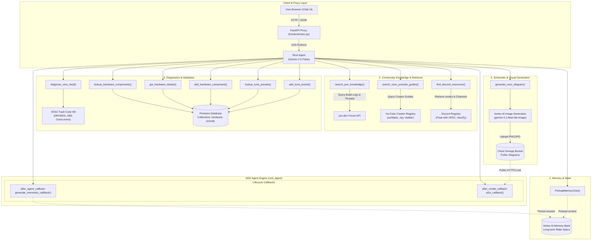

# VESC Copilot - Complete Architecture & Local Setup Handoff Guide

> **Important**: This guide contains everything required to recreate, configure, run, and deploy **VESC Copilot** from scratch on your local machine using your personal Google Cloud account and the Antigravity IDE/CLI.

---

## 1. Executive Summary & Architecture Overview

**VESC Copilot** is a domain-expert autonomous AI assistant for DIY Personal Electric Vehicles (PEVs) such as VESC Onewheel conversions, e-skateboards, and e-bikes.

```
┌─────────────────────────────────────────────────────────────┐
│                       User Browser                          │
│   (Custom Chat UI with Dark Mode, Prompt Chips, A2UI cards) │
└──────────────────────────────┬──────────────────────────────┘
                               │ HTTP / JSON (/chat)
┌──────────────────────────────▼──────────────────────────────┐
│                    FastAPI Proxy (frontend/)                │
│    - Authenticates via ADC (Google Cloud Credentials)       │
│    - Maintains user session contexts                        │
│    - Communicates over Google A2A Protocol                  │
└──────────────────────────────┬──────────────────────────────┘
                               │ A2A Stream (RPC)
┌──────────────────────────────▼──────────────────────────────┐
│         Vertex AI Agent Engine (Reasoning Engine)           │
│                   google-adk / Gemini 2.5                   │
├─────────────────────────────────────────────────────────────┤
│  Tools & Integrations:                                      │
│  1. Firestore DB: Hardware catalog & tune presets           │
│  2. Vertex AI Memory Bank: Cross-session rider memory       │
│  3. Imagen / Gemini Image Gen: Technical wiring schematics  │
│  4. Cloud Storage: Public bucket for hosting schematics     │
│  5. pev.dev Forum Retrieval: Real DIY build logs & guides   │
│  6. YouTube Service: Video links from creator channels      │
│  7. Discord Service: Direct community invite links          │
│  8. A2UI Catalog v0.8: Formats rich cards with citations    │
└─────────────────────────────────────────────────────────────┘
```

---


### 1.1 Agent Architecture & Tool Suite Diagram

The diagram below details the internal structure of **`root_agent`**, its execution pipeline, callbacks, and the suite of 11 tools categorized by their function:



### 1.2 Registered Tool Suite Reference Table

| Category | Tool Function | Purpose & Backend Service |
| :--- | :--- | :--- |
| **Memory** | `PreloadMemoryTool` | Preloads saved user facts (motor specs, battery voltage, rider weight) from **Vertex AI Memory Bank**. |
| **Community** | `search_pev_knowledge` | Fetches forum posts and troubleshooting logs from **pev.dev**. |
| **Community** | `search_vesc_youtube_guides` | Returns curated video guides by creators like *surfdado*, *Jay is Doing Stuff*, and *Benjamin Vedder*. |
| **Community** | `find_discord_resources` | Returns direct community Discord invites and channel guides (*Float with VESC*, *VESC Development*, *Vescify*). |
| **Diagnostics** | `diagnose_vesc_fault` | Provides root-cause analysis and hardware mitigation for VESC terminal faults (`FAULT_CODE_DRV`, `ABS_OVER_CURRENT`, `FAULT_CODE_HIGH_OFFSET_CURRENT_SENSOR_1`). |
| **Hardware DB** | `lookup_hardware_components` | Lists and filters controllers, motors, batteries, and BMS options from **Firestore**. |
| **Hardware DB** | `get_hardware_details` | Retrieves full technical electrical specs (continuous current, peak current, voltage ceiling) from **Firestore**. |
| **Hardware DB** | `add_hardware_component` | Allows the agent to save newly announced controller hardware into **Firestore**. |
| **Tuning DB** | `lookup_tune_presets` | Retrieves community balance presets (PID gains, tiltback angle, field weakening) from **Firestore**. |
| **Tuning DB** | `add_tune_preset` | Persists custom rider balance presets into **Firestore**. |
| **Schematics** | `generate_vesc_diagram` | Generates technical wiring diagrams using **Vertex AI Image Generation** and hosts them on **Cloud Storage**. |

---

## 2. Prerequisites for Your Local Machine

Ensure your laptop has the following tools installed:
- **Git**: `git --version`
- **Python 3.11+**: `python3 --version`
- **uv** (Fast Python package manager):
  ```bash
  curl -LsSf https://astral.sh/uv/install.sh | sh
  ```
- **Google Cloud SDK (`gcloud`)**: [Install instructions](https://cloud.google.com/sdk/docs/install)
- **google-agents-cli**:
  ```bash
  uv tool install google-agents-cli
  ```
- **Antigravity CLI / Antigravity IDE**: (If using Google Antigravity).

---

## 3. Google Cloud Project Setup

On your personal Google Cloud account:

### Step 3.1: Create or Select a GCP Project
```bash
export PROJECT_ID="your-personal-gcp-project-id"
export REGION="us-east1"

gcloud config set project $PROJECT_ID
```

### Step 3.2: Enable Required APIs
```bash
gcloud services enable \
  aiplatform.googleapis.com \
  firestore.googleapis.com \
  storage.googleapis.com \
  run.googleapis.com \
  cloudbuild.googleapis.com \
  artifactregistry.googleapis.com
```

### Step 3.3: Set Up Firestore
1. Go to **Google Cloud Console > Firestore**.
2. Create a database in **Native mode** (Default database: `(default)` in your region, e.g., `us-east1` or `nam5`).

### Step 3.4: Create a Public Cloud Storage Bucket for Diagrams
```bash
export BUCKET_NAME="vesc-diagrams-$PROJECT_ID"

# Create bucket
gcloud storage buckets create gs://$BUCKET_NAME --location=$REGION

# Make bucket objects publicly readable for browser image rendering
gcloud storage buckets add-iam-policy-binding gs://$BUCKET_NAME \
  --member=allUsers \
  --role=roles/storage.objectViewer
```

---

## 4. Local Workspace Initialization

### Step 4.1: Clone Your Repository
```bash
git clone https://github.com/conradopoole/buildwithgemini-vesc-copilot.git
cd buildwithgemini-vesc-copilot
```

### Step 4.2: Authenticate Locally
Authenticate your local shell with Google Cloud:
```bash
gcloud auth login
gcloud auth application-default login
```

### Step 4.3: Configure `.env`
Create a `.env` file in the root directory:
```bash
cat << "ENV_EOF" > .env
GOOGLE_CLOUD_PROJECT=$PROJECT_ID
GOOGLE_CLOUD_LOCATION=$REGION
GCS_IMAGE_BUCKET=$BUCKET_NAME
# Optional: MEMORY_BANK_ID=projects/<your-project-number>/locations/us-east1/memoryBanks/<id>
ENV_EOF
```

---

## 5. Seed Firestore Hardware Catalog

Populate the Firestore database with modern and commonly used flagship controllers (Fungineers Thor400, Thor301, Zeus400; Floatwheel GTV Kit, PintV Kit, ADV500, ADV200; JetFleet F6, G18 GaN; ENNOID MK8, MK8 Pro, MK9 Pro) alongside motors, BMS units, and baseline tuning presets:
```bash
uv venv
source .venv/bin/activate
uv pip install -r pyproject.toml
python seed_db.py
```

---

## 6. Running Locally in Development

You can run the agent locally using the built-in playground or run the FastAPI chat frontend.

### Option A: ADK / Agent Playground
```bash
agents-cli playground
# Opens http://localhost:8000 with live reload and debugging
```

### Option B: Run the Full Chat UI Frontend
```bash
cd frontend
python3 -m venv .venv
source .venv/bin/activate
pip install -r requirements.txt

# Set your deployed agent resource name or run against local:
export AGENT_ENGINE_RESOURCE_NAME="projects/<project-num>/locations/<region>/reasoningEngines/<id>"
export AGENT_DIRECTORY="app"
export PORT="8080"

python main.py
# Open http://localhost:8080
```

---

## 7. Deploying to Production on Google Cloud

### Step 7.1: Deploy the Agent to Vertex AI Agent Platform
From the repository root:
```bash
agents-cli deploy --project $PROJECT_ID
```
*Note down the resulting `Remote Agent Engine Resource Name` printed in the output.*

### Step 7.2: Grant Agent Engine Service Account Permissions
Vertex AI Agent Engine runs under a generated service agent:
`service-<PROJECT_NUMBER>@gcp-sa-aiplatform-re.iam.gserviceaccount.com`

Grant it permissions for Firestore and Cloud Storage:
```bash
PROJECT_NUM=$(gcloud projects describe $PROJECT_ID --format="value(projectNumber)")
AGENT_SA="service-${PROJECT_NUM}@gcp-sa-aiplatform-re.iam.gserviceaccount.com"

# Firestore access
gcloud projects add-iam-policy-binding $PROJECT_ID \
  --member="serviceAccount:$AGENT_SA" \
  --role="roles/datastore.user"

# Storage access to save diagrams
gcloud projects add-iam-policy-binding $PROJECT_ID \
  --member="serviceAccount:$AGENT_SA" \
  --role="roles/storage.objectAdmin"
```

### Step 7.3: Deploy Chat Frontend to Cloud Run
```bash
cd frontend

# Grant Compute Engine default service account access to call Vertex AI Agent Engine
COMPUTE_SA="${PROJECT_NUM}-compute@developer.gserviceaccount.com"
gcloud projects add-iam-policy-binding $PROJECT_ID \
  --member="serviceAccount:$COMPUTE_SA" \
  --role="roles/aiplatform.user"

# Deploy to Cloud Run
gcloud run deploy vesc-copilot-frontend \
  --source . \
  --region $REGION \
  --project $PROJECT_ID \
  --service-account $COMPUTE_SA \
  --set-env-vars AGENT_ENGINE_RESOURCE_NAME="<PASTE_AGENT_ENGINE_RESOURCE_NAME>",AGENT_DIRECTORY="app" \
  --allow-unauthenticated
```

---

## 8. Key Code Files & Directory Map

| Path | Purpose |
| :--- | :--- |
| `app/agent.py` | Core ADK root agent, prompt configuration, tool registrations, and A2UI schema manager. |
| `app/firestore_service.py` | Hardware catalog & presets lookup from Firestore DB. |
| `app/pev_service.py` | `pev.dev` community forum search integration. |
| `app/youtube_service.py` | Video tutorial searches for creators (surfdado, Jay is Doing Stuff, Vedder). |
| `app/discord_service.py` | Curated Discord community invite and channel mapping. |
| `app/image_service.py` | Technical schematic generator using Gemini Imagen + Cloud Storage. |
| `frontend/main.py` | FastAPI proxy translating browser requests to Agent Engine over the A2A protocol. |
| `frontend/static/index.html` | Custom chat UI: dark mode, typing indicator, quick prompt chips, A2UI renderer, lightbox modal, and markdown auto-link parser. |
| `frontend/Dockerfile` | Container build definition for Cloud Run. |
| `seed_db.py` | Script to seed initial VESC hardware and tune presets into Firestore. |
| `vesc_copilot_demo.mp4` | Recorded video demonstration with upbeat lo-fi soundtrack. |

---

## 9. Antigravity Specific Tips

If developing with **Antigravity CLI** or **Antigravity IDE**:
- Skills and configurations are located in `.agents/skills/`.
- Project guidelines and instructions are defined in `GEMINI.md`.
- You can invoke subagents for testing, code refinement, or eval workflows using `agents-cli eval`.
